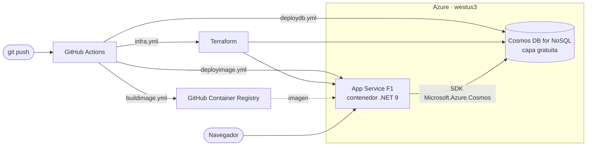

# TacnaGo · Guía de lugares de Tacna con Azure Cosmos DB for NoSQL

App web y API REST en **.NET 9** que guarda lugares turísticos de Tacna como **documentos JSON** en **Azure Cosmos DB for NoSQL** (API nativa de Cosmos DB, no la API de MongoDB). La infraestructura se crea con **Terraform** y todo se despliega con **GitHub Actions** en **Azure App Service**.

- **App publicada:** https://app-tacnago-geraldzvallos.azurewebsites.net
- **API (Swagger):** https://app-tacnago-geraldzvallos.azurewebsites.net/swagger

> Actividad Grupal 01 (Unidad 2) · Base de Datos II · Universidad Privada de Tacna
> Integrantes: Gerald Deybi Zevallos Pinto y Kevin Elvis Hinojosa Calloapaza

## Arquitectura



| Pieza | Servicio | Costo |
|---|---|---|
| Base de datos NoSQL | Azure Cosmos DB for NoSQL, base `TacnaGo` de 400 RU/s dentro de la cuenta con capa gratuita de la suscripción (1000 RU/s y 25 GB gratis por cuenta) | 0 |
| Backend + página web | Azure App Service Linux, plan F1, contenedor | 0 |
| Imagen Docker | GitHub Container Registry (ghcr.io) | 0 |
| Estado de Terraform | Azure Storage Account (Standard LRS) | céntimos |

## Modelo de datos

- Base de datos `TacnaGo` con 400 RU/s compartidos; contenedor `Lugares`.
- **Clave de partición: `/categoria`** (historia, museos, playas, gastronomia, naturaleza, pueblos). Todos los lugares de una categoría viven en la misma partición lógica, así que listar una categoría es una consulta a una sola partición.
- Cada documento puede traer campos distintos en `detalles` (esquema flexible).

```json
{
  "id": "picanterias-de-pocollay",
  "categoria": "gastronomia",
  "nombre": "Picanterías de Pocollay",
  "provincia": "Tacna",
  "distrito": "Pocollay",
  "descripcion": "Restaurantes campestres donde se prueba el picante a la tacneña y la patasca.",
  "tags": ["comida tipica", "campestre", "familia"],
  "detalles": { "platoTipico": "Picante a la tacneña" }
}
```

## API

Cada respuesta trae el encabezado `x-ru-charge` con el costo de la operación en Request Units.

| Método | Ruta | Operación en Cosmos DB |
|---|---|---|
| GET | `/api/lugares` | Consulta entre particiones (`ORDER BY c.nombre`) |
| GET | `/api/lugares?categoria=museos` | Consulta en una sola partición |
| GET | `/api/lugares/buscar?tag=playa` | `ARRAY_CONTAINS(c.tags, @tag)` |
| GET | `/api/categorias` | `GROUP BY c.categoria` con `COUNT(1)` |
| GET | `/api/lugares/{categoria}/{id}` | Lectura puntual (id + clave de partición) |
| POST | `/api/lugares` | Crear documento |
| PUT | `/api/lugares/{categoria}/{id}` | Reemplazar documento (la categoría no cambia) |
| DELETE | `/api/lugares/{categoria}/{id}` | Eliminar documento |

## Despliegue automatizado (GitHub Actions)

| Workflow | Cuándo corre | Qué hace |
|---|---|---|
| `infra.yml` | push en `infra/` | Crea el estado de Terraform si no existe y aplica `infra/main.tf`: grupo de recursos, base y contenedor de Cosmos DB, y App Service |
| `deploydb.yml` | al terminar `infra.yml` o push en `data/` | Carga `data/lugares.json` con el SDK de Python (`upsert`) |
| `buildimage.yml` | push en `TacnaGo.Api/` o `Dockerfile` | Construye la imagen y la publica en `ghcr.io/geraldzvallos/tacnago-api` |
| `deployimage.yml` | al terminar `buildimage.yml` | Despliega la imagen en App Service y prueba la URL |

Secrets del repositorio: `AZURE_CLIENT_ID`, `AZURE_CLIENT_SECRET`, `AZURE_TENANT_ID`, `AZURE_SUBSCRIPTION_ID` (service principal con rol Contributor) y `GHCR_PAT` (token con `read:packages` para que App Service descargue la imagen). La clave de Cosmos DB no está en GitHub: Terraform la pasa directamente a la configuración de la Web App.

## Estrategia de respaldo (Actividad Grupal 02)

| Capa | Qué hace | Dónde | Retención |
|---|---|---|---|
| 1. Respaldo nativo de Cosmos DB | Copias automáticas periódicas de toda la cuenta (cada 4 horas, 2 copias), administradas por Azure | Almacenamiento de Azure (geo-redundante) | 8 horas |
| 2. Respaldo lógico diario | `backup.yml` exporta el contenedor `Lugares` a JSON comprimido con SHA-256 | Azure Blob Storage `sttacnagobkgerald/cosmos-backups` (versionado y borrado temporal de 7 días) | Hot 7 días, Cool hasta el día 37 |
| 3. Copia fuera de Azure | El mismo archivo como artefacto de GitHub Actions | GitHub | 30 días |
| 4. Prueba de restauración | `restore.yml` restaura cada domingo el último respaldo en `Lugares-restore` y verifica la cantidad y cada id | Cosmos DB | — |

- **RPO (pérdida máxima de datos):** 24 horas con el respaldo lógico; hasta 4 horas con el respaldo nativo.
- **RTO (tiempo de recuperación):** unos minutos: se ejecuta `restore.yml` con destino `Lugares`.
- La app muestra los respaldos guardados en la sección *Respaldos de la base de datos* y en `GET /api/respaldos`.

| Workflow | Cuándo corre | Qué hace |
|---|---|---|
| `backup.yml` | todos los días a las 00:00 (Perú) o manual | exporta, sube a Blob Storage y guarda el artefacto |
| `restore.yml` | cada domingo (prueba) o manual | descarga un respaldo, verifica su SHA-256, lo restaura y comprueba los documentos |

## Ejecutar en local

Requisitos: .NET 9 SDK y una cuenta de Cosmos DB (o el emulador).

```powershell
cd TacnaGo.Api
$env:Cosmos__Endpoint = "https://<tu-cuenta>.documents.azure.com:443/"
$env:Cosmos__Key = "<clave>"
dotnet run
# http://localhost:5080  y  http://localhost:5080/swagger
```

Con Docker:

```powershell
docker build -t tacnago-api .
docker run -p 8080:8080 -e Cosmos__Endpoint=... -e Cosmos__Key=... tacnago-api
```

## Estructura

```
TacnaGo.Api/          API (Minimal API) + página web en wwwroot/
  Models/             Lugar, CategoriaResumen, CosmosSettings
  Services/           LugaresRepository (consultas y operaciones en Cosmos DB)
infra/main.tf         Terraform: Cosmos DB + App Service
data/                 lugares.json y seed.py (carga de datos)
backup/               backup.py (respaldo lógico) y restore.py (restauración verificada)
.github/workflows/    infra, deploydb, buildimage, deployimage, backup, restore
Dockerfile            imagen de dos etapas (SDK -> runtime ASP.NET)
```

## Licencia

MIT
